# quartz

A granular texture synth for [norns](https://monome.org/docs/norns/), running the open-source Beads DSP by Emilie Gillet.

Feed it audio and it becomes a cloud of tiny grains. Or switch to the built-in wavetable synth and play it as a drone, from your instrument's pitch, or from a MIDI keyboard. Grid, arc, and crow are all optional extras.

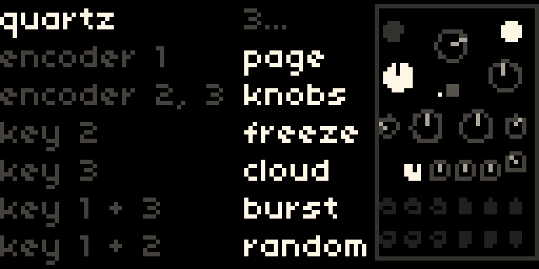

## Install

1. Copy the `quartz` folder into `dust/code/` on your norns. Over Wi-Fi, connect to `smb://norns.local` (user `we`, password `sleep`).
2. Run quartz once. It installs its sound engine and asks you to restart: **SYSTEM > RESTART**.
3. Run quartz again.

## The basics

| Control | Does |
|---|---|
| Encoder 1 | page |
| Encoder 2, 3 | the two knobs shown on the page |
| Key 2 | freeze |
| Key 3 | cloud on/off |
| Key 1 + key 3 | burst of grains while held |
| Key 1 + key 2 | random patch |
| Hold key 1 | help |

When quartz starts, the help screen shows for a 3, 2, 1 countdown. Hold key 1 any time to see it again. The panel on the right mirrors the Beads module's layout: every knob shows its value, and the two on your current page light up.

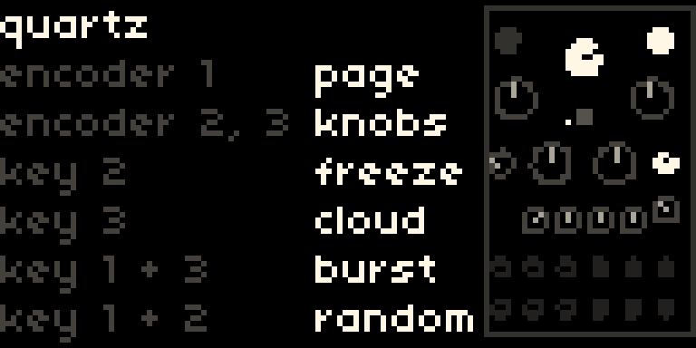

The specks across the screen are the cloud: busier with more density, longer with bigger grains, and still when frozen.

## Pages

Like Beads, each main knob shares a page with its attenurandomizer, the knob that adds randomness to it.

### 1 time
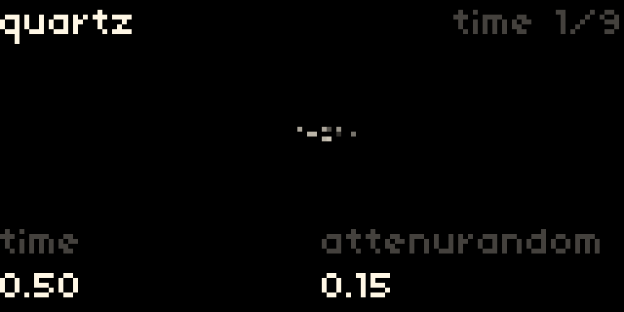

- **time:** how far back in the recording grains read from
- **attenurandom:** randomness on time

### 2 size
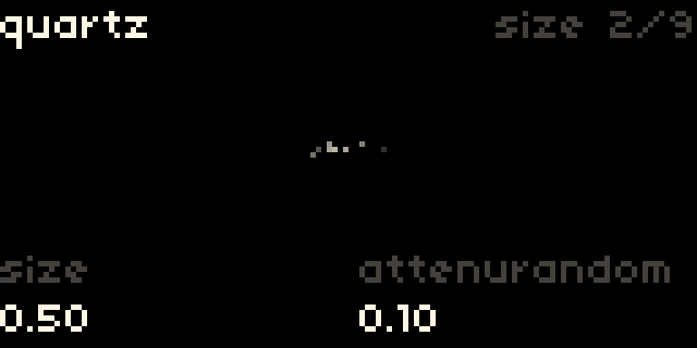

- **size:** grain length. All the way right switches to delay mode
- **attenurandom:** randomness on size

### 3 shape
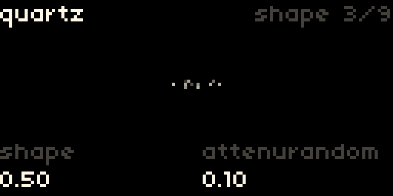

- **shape:** grain envelope, from clicky to soft swells
- **attenurandom:** randomness on shape

### 4 pitch
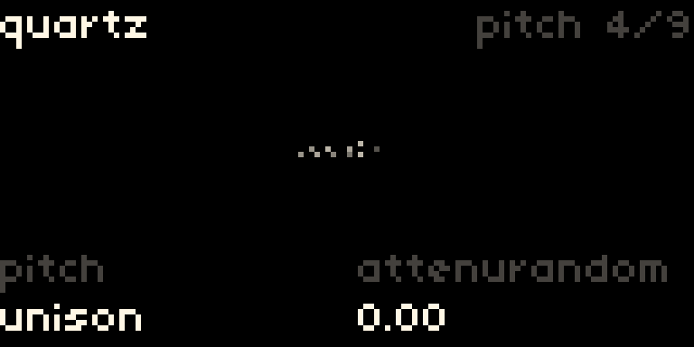

- **pitch:** shown as intervals, like `+5th` or `-oct`
- **attenurandom:** randomness on pitch. Starts at zero so things stay in tune

### 5 cloud
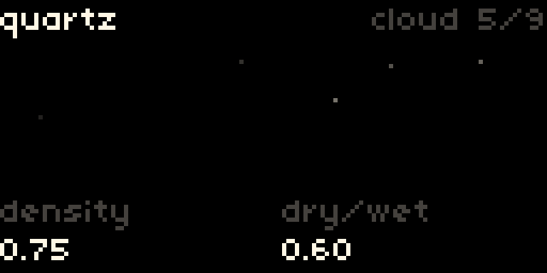

- **density:** center is silent. Left gives steady grains, right gives random ones, more the farther you turn
- **dry/wet:** your input vs the cloud

### 6 space
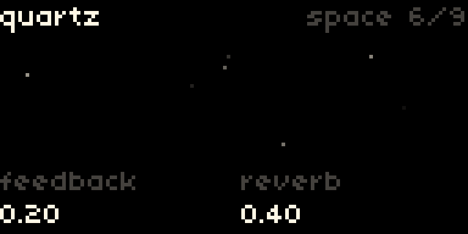

- **feedback:** longer, smeared tails
- **reverb:** subtle in the lower half, a big wash above 0.7

### 7 media
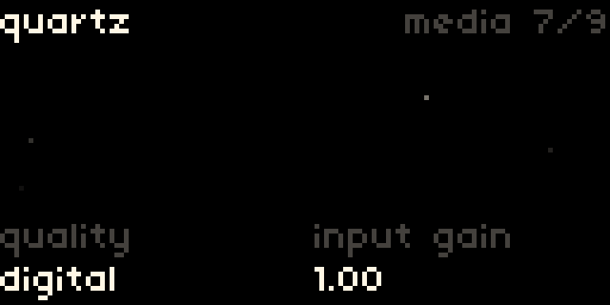

- **quality:** dirty tape, clean tape, vintage digital, or digital. Changes the buffer's length and character
- **input gain**

### 8 voice
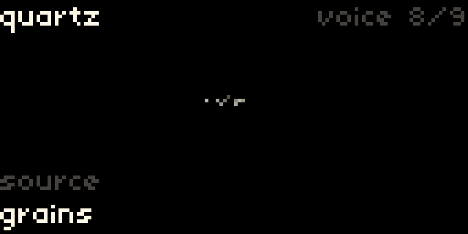

- **source:** what feeds the cloud (see below)
- **octave:** for synth follow and synth midi. With the sample source, this becomes **sample speed**

### 9 patch
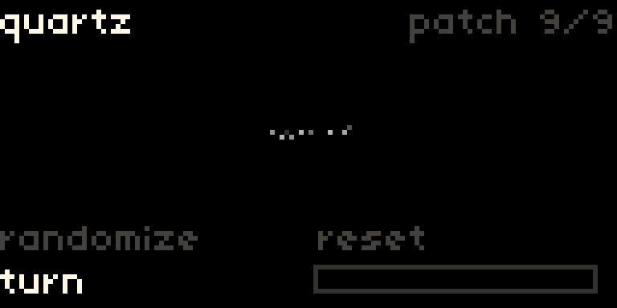

- **randomize:** every few clicks of encoder 2 rolls a new patch. Random but musical: no silent density, no accidental delay mode, pitch on fifths and octaves
- **reset:** turn encoder 3 until the bar fills. Hard to do by accident

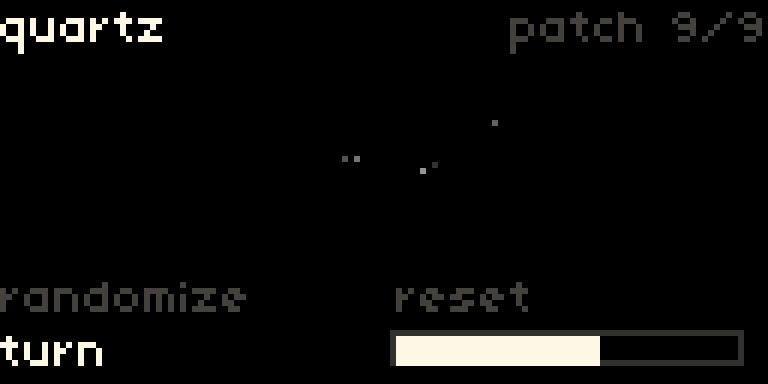

Both only touch the sound knobs, never your source, input, or MIDI setup. The title flashes to confirm:

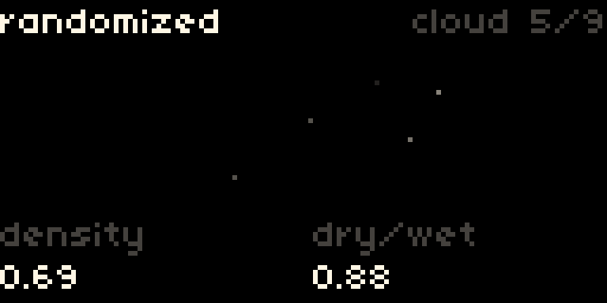

## Status

Key 2 freezes the buffer, so you can scrub it with time. Key 3 turns the cloud off.

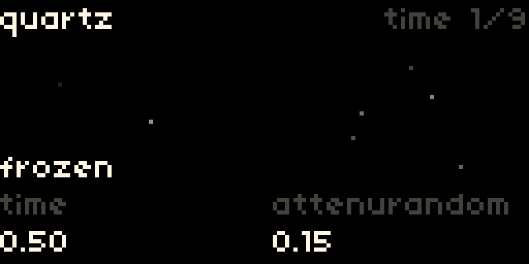
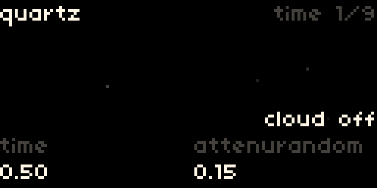

## Sources

| Source | What you hear |
|---|---|
| grains | your live input, turned into a cloud |
| synth drone | the wavetable synth, playing nonstop at the pitch you set |
| synth follow | the synth playing the notes it hears from your input. Single notes work best, bass most of all |
| synth midi | the synth played from a MIDI keyboard. Sustain pedal freezes |
| sample | a sound file from your norns audio library, looping into the grains like live input |

To use the sample source, pick a file in **PARAMS > sample file** (it browses `dust/audio`). **Sample speed** runs from -2x to 2x, so you can play it slower, faster, or in reverse.

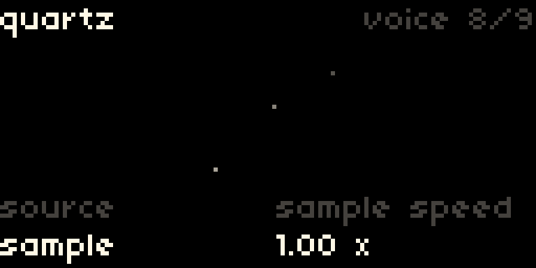

In the synth sources, a few knobs take on their synth meaning, and the screen relabels them:

- **pitch** becomes the note itself in synth drone, like `C3`
- **feedback** becomes **wavetable**, picking bank 1 to 12
- **dry/wet** becomes **osc/cloud**
- **quality** becomes **bit depth**, 4-bit to 16-bit

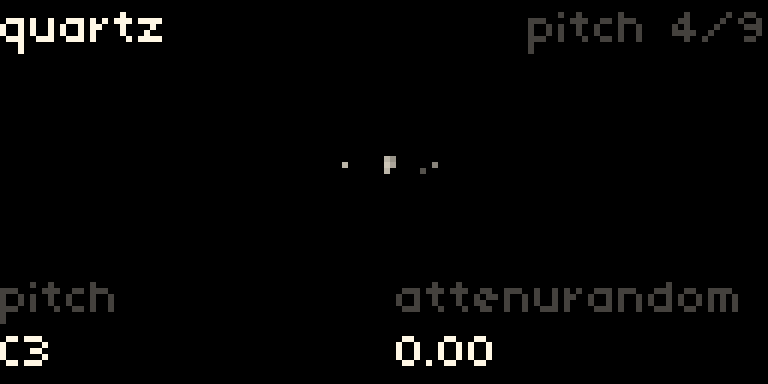
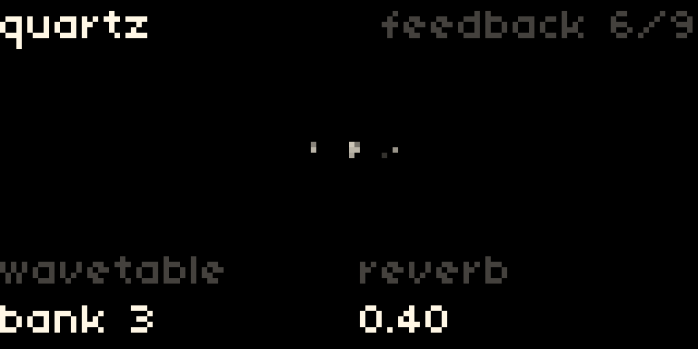
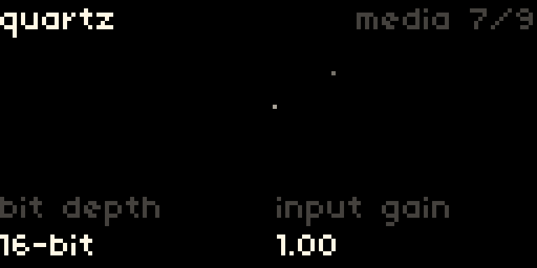
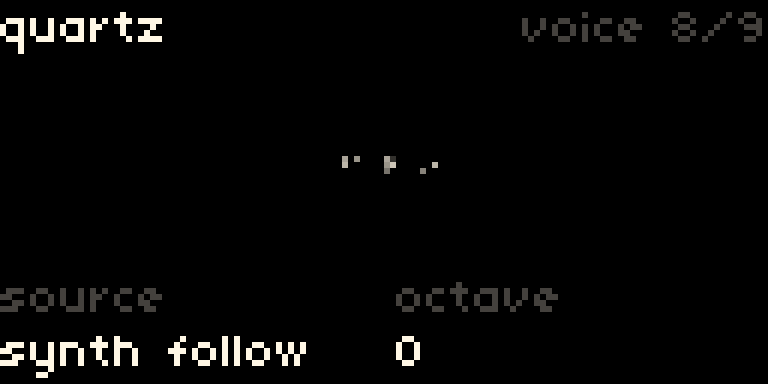

Settings that only matter for some sources (octave, release, dry level, pitch follow, follow threshold, sample file, sample speed) hide when you don't need them.

## Grid, arc, crow

- **Grid** mirrors the cloud, each grain lighting a key and fading.
- **Arc** rings 1 and 2 are encoders 2 and 3, showing the current page's knobs. Ring 3 flips pages, with the current one lit.
- **Crow** is set up in PARAMS > crow. Inputs can be seed clock, freeze gate, CV to any knob, or V/oct to pitch. Outputs can be the followed pitch, the cloud's envelope, random CV, or a freeze gate.

If your grid or arc runs iii firmware, switch it to standard mode first: hold its key (top-left key on grid) while plugging it in, and look for the "particles" startup pattern. Plug devices in before powering norns.

## Building the sound engine yourself

`src/` has the SuperCollider UGen wrapper and the vendored DSP. `bin/quartz-plugin` is a prebuilt binary for norns. To rebuild on norns: `./build.sh g++ Quartz.so`, with SuperCollider headers available.

## Credits

The DSP is Mutable Instruments' Beads by Emilie Gillet, MIT license (see the headers in `src/third_party`). quartz is not affiliated with or endorsed by Mutable Instruments.
