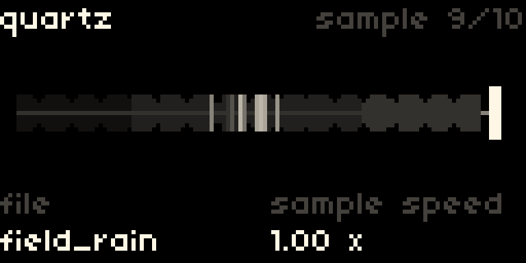

# quartz

A granular texture synth for [norns](https://monome.org/docs/norns/), running the open-source Beads DSP by Emilie Gillet. Feed it audio and it becomes a cloud of grains, or play its wavetable synth.


## Install

From maiden:

```
;install https://github.com/req-kuj/quartz
```

Then run quartz once. It installs its sound engine and asks for **SYSTEM > RESTART**. Run it again and you're set.

To update, delete `dust/code/quartz` and install again. If an update includes a new sound engine, quartz asks for one more restart. Settings are remembered between sessions.

## Controls

| Control | Does |
|---|---|
| Encoder 1 | page |
| Encoder 2, 3 | the two knobs shown on the page |
| Key 2 | freeze |
| Key 3 | cloud on/off |
| Key 1 + key 3 | burst of grains while held |
| Key 1 + key 2 | random patch |
| Hold key 1 | help |

The help screen shows for a 3, 2, 1 countdown at launch, and whenever you hold key 1. Its panel follows the Beads module's layout: every knob shows its value, and the two on your current page light up.


The specks are the grains: left to right is time, height is pitch.

## Pages

Each page is named after its first knob. The first four pair a main knob with its attenurandomizer, the way Beads does.

| Page | Encoder 2 | Encoder 3 |
|---|---|---|
| 1 time | how far back in the recording grains read from | attenurandom |
| 2 size | grain length; all the way right is delay mode | attenurandom |
| 3 shape | grain envelope, clicky to soft swells | attenurandom |
| 4 pitch | shown as intervals, like `+5th` or `-oct` | attenurandom, starts at zero to stay in tune |
| 5 density | center is silent, left is steady, right is random | dry/wet |
| 6 feedback | longer, smeared tails | reverb: subtle below 0.5, a big wash above 0.7 |
| 7 quality | dirty tape, clean tape, vintage digital, digital | input gain |
| 8 source | what feeds the cloud (below) | octave, for synth follow and synth midi |
| patch | randomize: every few clicks rolls a new patch | reset: turn until the bar fills |


Randomize leaves the attenurandomizers alone. Neither randomize nor reset touches your source or MIDI setup.


Freeze holds the buffer so you can scrub it with time. Grains keep playing from what's frozen, as on Beads.

## Sources

| Source | What you hear |
|---|---|
| grains | your live input, turned into a cloud |
| synth drone | the wavetable synth, playing nonstop at the pitch you set |
| synth follow | the synth playing the notes it hears from your input |
| synth midi | the synth played from a MIDI keyboard or the grid. Sustain pedal freezes |
| sample | a sound file from `dust/audio`, looping into the grains like live input |

The sample source adds a page before patch. Turn encoder 2 there to open the file browser (key 3 picks, key 2 backs out). Encoder 3 sets speed from -2x to 2x, so reverse works too.



In the synth sources, the screen relabels knobs that change meaning.


## Grid, arc, crow

Grid mirrors the cloud. In synth midi it turns into a keyboard laid out like [doubledecker](https://github.com/sixolet/doubledecker): a semitone per key across, a fourth per row up. C keys are brighter, and held notes light up, including ones from a MIDI keyboard.

Arc lines up with norns sitting above it: ring 1 turns pages, rings 2 and 3 match encoders 2 and 3. Pages and choices sweep like a knob, lower left to lower right.

Crow is set up in PARAMS > crow. Inputs: seed clock, freeze gate, CV to any knob, or V/oct to pitch. Outputs: followed pitch, the cloud's envelope, random CV, or a freeze gate.

## Known limits

- Synth follow tracks single notes. Chords confuse it, and bass tracks best.
- Crow support hasn't been tested on hardware yet.
- Samples must be WAV, AIFF, or FLAC. MP3 won't load. The whole file loops.
- Grains mode uses about 35% CPU on a stock norns, more with high density and big grains.
- The specks are drawn from your settings, not read from the engine, so they show the shape of the cloud rather than each actual grain.
- Plug in grid and arc before powering norns. Hot-plugging can brown it out. If either runs iii firmware, hold its key (top-left on grid) while plugging in and look for the "particles" pattern to switch it to standard mode.

## Building the sound engine

`src/` has the SuperCollider UGen wrapper and the vendored DSP. `bin/quartz-plugin` is a prebuilt binary for norns. To rebuild on norns: `./build.sh g++ Quartz.so`, with SuperCollider headers available.

## Credits

The DSP is Mutable Instruments' Beads by Emilie Gillet, MIT license (see the headers in `src/third_party`). quartz is not affiliated with or endorsed by Mutable Instruments.
